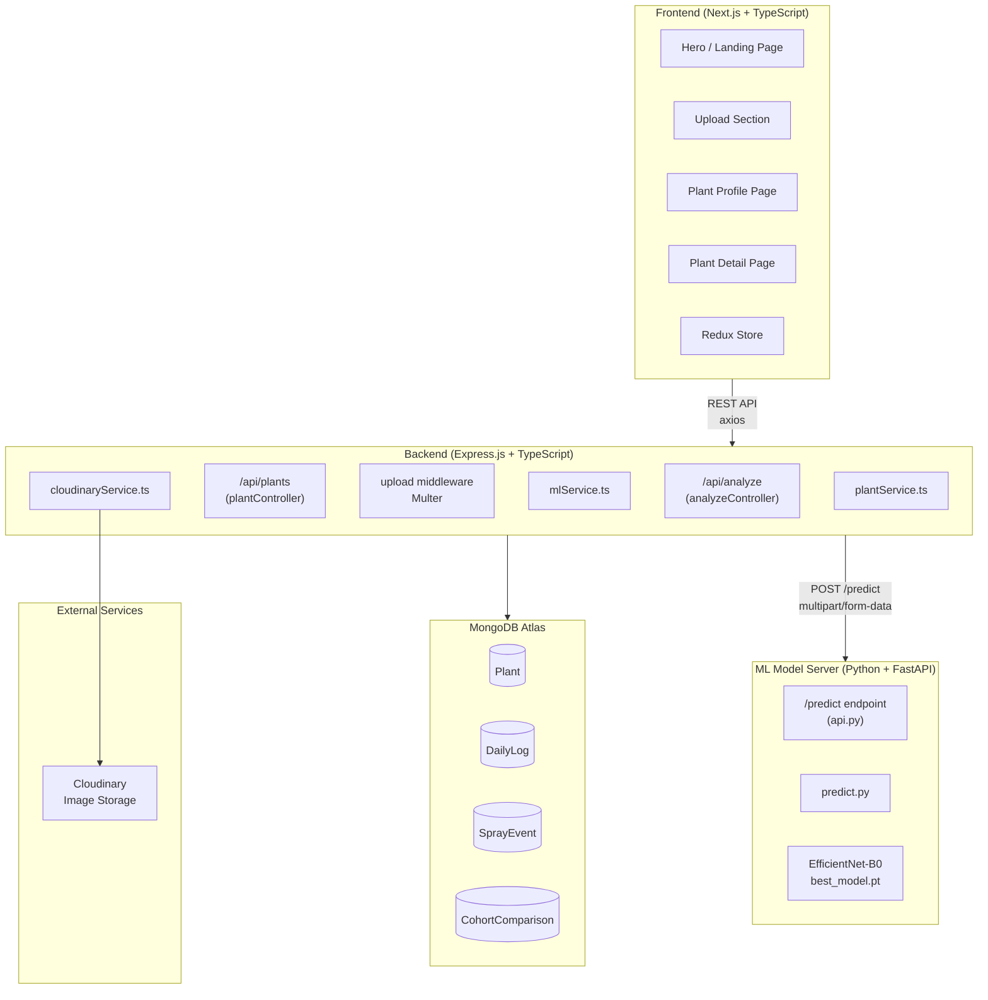
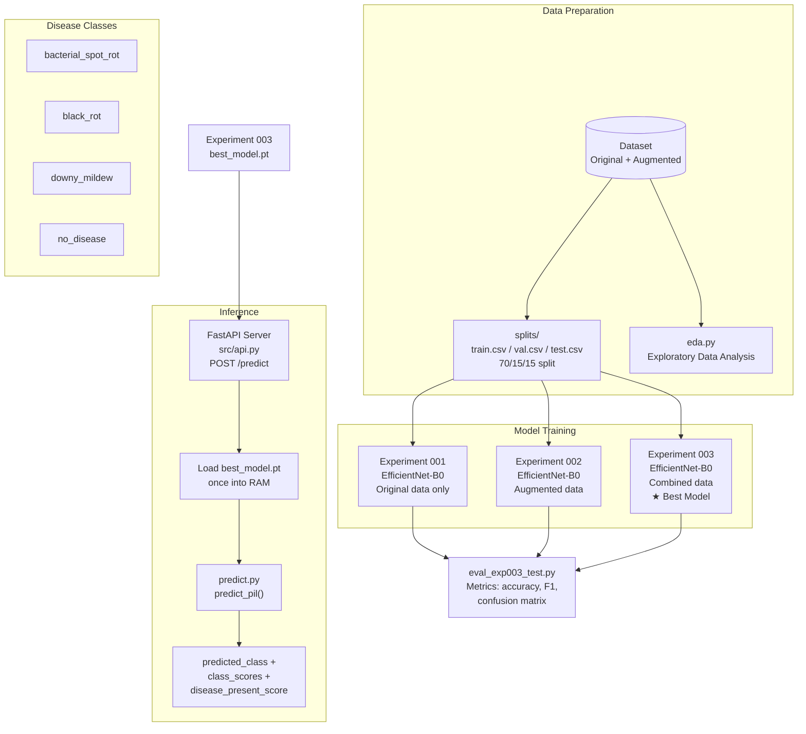
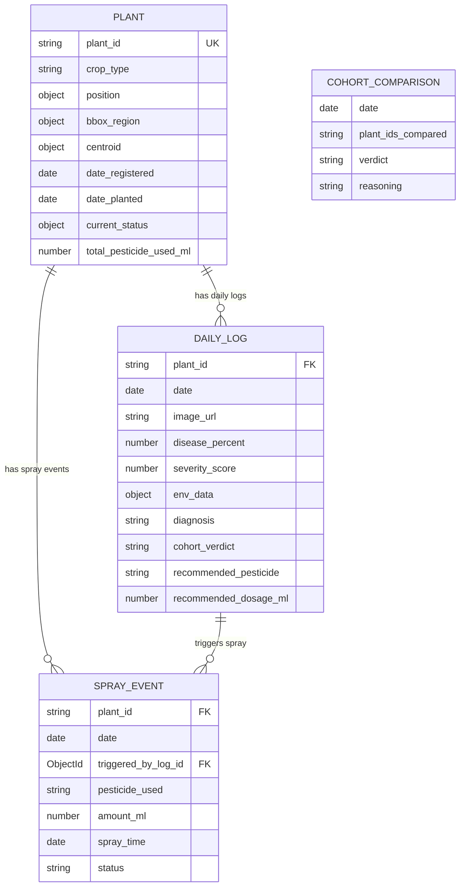
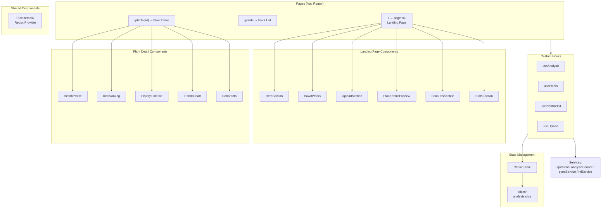
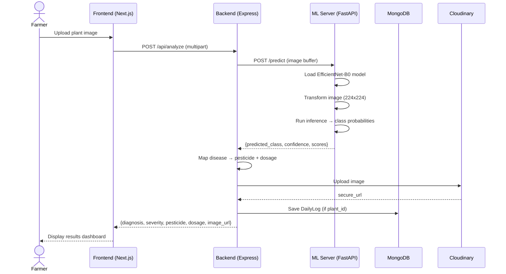

# DeepLeaf - Software Flowchart

## 1. System Architecture Overview

---

## 2. Image Analysis Flow (Core Feature)

```mermaid
flowchart TD
    START([Farmer opens DeepLeaf]) --> HOME[Landing Page loads<br/>HeroSection + UploadSection]
    HOME --> UPLOAD[Farmer selects plant image<br/>and optionally enters plant_id + env_data]
    UPLOAD --> SUBMIT[uploadAndAnalyze via<br/>analysisService.ts]

    subgraph FRONTEND_FLOW["Frontend"]
        SUBMIT --> AXIOS[apiClient.post /api/analyze<br/>multipart/form-data]
    end

    AXIOS --> MIDDLEWARE["Multer upload middleware<br/>stores image buffer in memory"]

    subgraph BACKEND_FLOW["Backend - analyzeController.ts"]
        MIDDLEWARE --> VALIDATE{Image file<br/>provided?}
        VALIDATE -- No --> ERR400[400 Error:<br/>No image file provided]
        VALIDATE -- Yes --> ML_CALL["mlService.analyzePlantImage<br/>POST to ML Server /predict"]
    end

    subgraph ML_FLOW["ML Server - FastAPI"]
        ML_CALL --> ENSURE[ensure_model_loaded<br/>Load best_model.pt if not cached]
        ENSURE --> PIL_OPEN["PIL Image.open<br/>from bytes"]
        PIL_OPEN --> TRANSFORM["Resize 256 → CenterCrop 224<br/>ImageNet normalization"]
        TRANSFORM --> INFERENCE["EfficientNet-B0 forward pass<br/>softmax → class probabilities"]
        INFERENCE --> FORMAT["format_prediction<br/>predicted_class, disease_score,<br/>disease_present_score, class_scores"]
        FORMAT --> ML_RESPONSE[Return JSON response]
    end

    ML_RESPONSE --> MAP["mlService.mapToMLPrediction<br/>Map disease → PESTICIDE_MAP<br/>Get pesticide + dosage"]

    MAP --> CLOUD["cloudinaryService.uploadImage<br/>Upload image to Cloudinary"]
    CLOUD --> IMAGE_URL[Get secure_url]

    IMAGE_URL --> HAS_PLANT{plant_id<br/>provided?}
    HAS_PLANT -- Yes --> SAVE_LOG["DailyLog.create<br/>Save: plant_id, date, image_url,<br/>disease_percent, severity_score,<br/>env_data, diagnosis,<br/>recommended_pesticide, dosage"]
    HAS_PLANT -- No --> RESPOND
    SAVE_LOG --> RESPOND["Return JSON response:<br/>diagnosis, severity_score,<br/>disease_percent, recommended_pesticide,<br/>recommended_dosage_ml, confidence, image_url"]

    RESPOND --> DISPLAY["Frontend displays results<br/>via Redux store → useAnalysis hook"]
    DISPLAY --> DONE([End])
```

---

## 3. Plant Management Flow

```mermaid
flowchart TD
    subgraph REGISTER["Register Plant Flow"]
        R1([POST /api/plants/register]) --> R2[plantController.registerPlant]
        R2 --> R3[plantService.registerPlant]
        R3 --> R4["Calculate centroid from bbox_region"]
        R4 --> R5["Plant.save() to MongoDB"]
        R5 --> R6[Return saved Plant document]
    end

    subgraph VIEW_PLANTS["View All Plants"]
        V1([GET /api/plants]) --> V2[plantController.getAllPlants]
        V2 --> V3["Plant.find().sort(plant_id)"]
        V3 --> V4[Return all plants]
    end

    subgraph PLANT_DETAIL["Plant Detail Flow"]
        PD1([GET /api/plants/:id]) --> PD2[plantController.getPlantById]
        PD2 --> PD3["Plant.findOne(plant_id)"]
        PD3 --> PD4{Found?}
        PD4 -- No --> PD5[404 Not Found]
        PD4 -- Yes --> PD6[Return plant]
    end

    subgraph PLANT_LOGS["Daily Logs Flow"]
        PL1([GET /api/plants/:id/logs]) --> PL2[plantController.getPlantLogs]
        PL2 --> PL3["DailyLog.find(plant_id).sort(date:-1)"]
        PL3 --> PL4[Return logs array]
    end

    subgraph SPRAY_HISTORY["Spray History Flow"]
        S1([GET /api/plants/:id/sprays]) --> S2[plantController.getPlantSprays]
        S2 --> S3["SprayEvent.find(plant_id).sort(date:-1)"]
        S3 --> S4[Return spray events]
    end
```

---

## 4. ML Training Pipeline (Plant_disease)

---

## 5. Data Model Relationships

---

## 6. Frontend Component Flow

---

## 7. End-to-End Request Lifecycle

